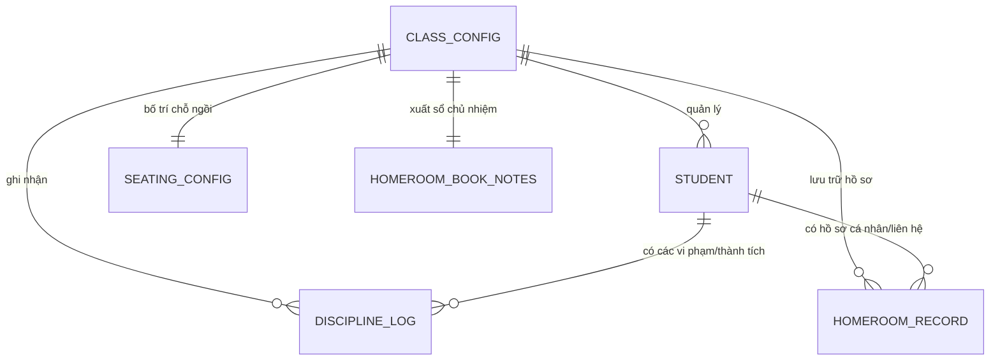
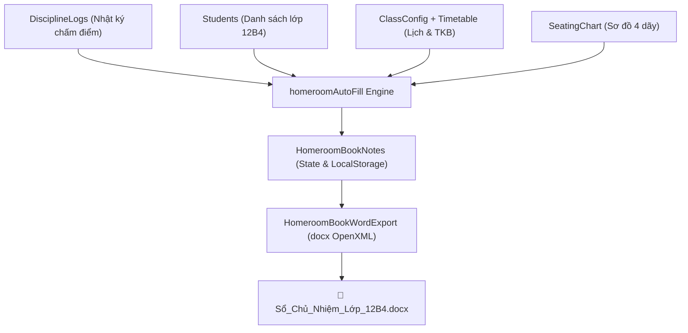

# Mô Hình Dữ Liệu (Phase 1 Data Model): Phân Hệ Trợ Lý GVCN

**Feature**: `001-review-tinh-nang-gvcn` | **Date**: 2026-11-05

---

## 1. Sơ Đồ Thực Thể Quan Hệ (Entity Relationship)



---

## 2. Chi Tiết Thực Thể (Entity Definitions)

### 2.1. `HomeroomBookNotes` (Nội dung Sổ Chủ Nhiệm)
Chứa toàn bộ các mục ghi chép kế hoạch và báo cáo định kỳ:

| Thuộc tính | Kiểu dữ liệu | Mô tả |
| :--- | :--- | :--- |
| `subjectTeachers` | `string` | Danh sách giáo viên bộ môn (Môn — Họ tên — SĐT) |
| `organization` | `string` | Cơ cấu ban cán sự và danh sách 4 tổ học tập |
| `seatingPlan` | `string` | Bố trí chỗ ngồi theo từng bàn / dãy |
| `classSituation` | `string` | Đặc điểm lớp, thuận lợi và khó khăn |
| `annualPlan` | `string` | Kế hoạch công tác chủ nhiệm cả năm học |
| `annualTargets` | `string` | Chỉ tiêu thi đua rèn luyện, học tập và danh hiệu lớp |
| `semesterReview` | `string` | Nhận xét đánh giá học kỳ và phương hướng |
| `studentFollowUp` | `string` | Theo dõi học sinh cần quan tâm (Nội dung — Biện pháp — Kết quả) |
| `parentCooperation` | `string` | Nhật ký phối hợp phụ huynh (Ngày — Nội dung — Kết quả) |
| `monthlyPlans` | `Record<number, string>` | Kế hoạch trọng tâm từng tháng (Tháng 9 đến Tháng 5) |
| `weeklyLearning` | `Record<number, string>` | Mục Học tập theo từng tuần (Tuần 1 đến Tuần 35) |
| `weeklyComments` | `Record<number, string>` | Mục Nhận xét theo từng tuần (Tuần 1 đến Tuần 35) |

---

### 2.2. `HomeroomRecord` (Hồ Sơ Trợ Lý GVCN Trên Cloud)
Quản lý các sự kiện chuyên sâu của lớp:

```typescript
export type HomeroomKind =
  | 'profile'     // Lý lịch trích ngang, thông tin phụ huynh, chính sách
  | 'contact'     // Nhật ký liên hệ gia đình học sinh
  | 'meeting'     // Biên bản sinh hoạt lớp tuần
  | 'task'        // Công việc / nhiệm vụ cần làm của GVCN
  | 'support'     // Kế hoạch trợ giúp học sinh cá biệt / khó khăn
  | 'collection'  // Thu quỹ lớp
  | 'payment'     // Chi quỹ lớp
  | 'allowance';  // Chế độ chính sách học sinh nghèo / mồ côi
```

---

### 2.3. `SeatingChartConfig` (Cấu Hình Sơ Đồ Chỗ Ngồi)
```typescript
export interface SeatingChartConfig {
  columns: number;        // Số dãy bàn (mặc định: 4 dãy)
  rows: number;           // Số bàn mỗi dãy (mặc định: 5 bàn)
  seatsPerDesk: number;   // Số học sinh / bàn (mặc định: 2 học sinh)
  teacherDesk: 'left' | 'right' | 'center'; // Vị trí bục giảng
  desks: Record<string, string[]>; // Map vị trí: `${col}_${row}` -> [studentId1, studentId2]
}
```

---

## 3. Luồng Chuyển Đổi Dữ Liệu (Data Transformation Pipeline)



