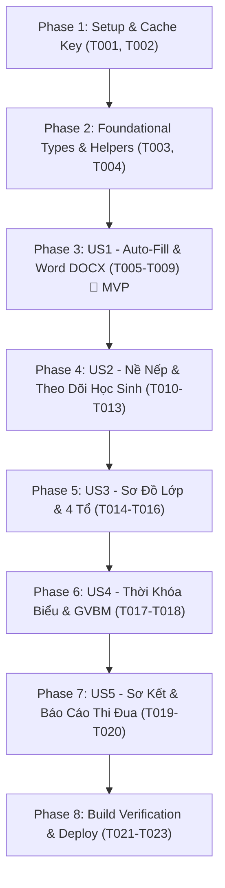

# Tasks: Review & Tối Ưu Phân Hệ Trợ Lý GVCN & Xuất Sổ Chủ Nhiệm

**Input**: Tài liệu thiết kế từ `/specs/001-review-tinh-nang-gvcn/` (`plan.md`, `spec.md`, `research.md`, `data-model.md`, `contracts/`)  
**Prerequisites**: React 18, TypeScript, Vite, docx OpenXML, Firebase Cloud Firestore  
**Feature Branch**: `001-review-tinh-nang-gvcn`  
**Chủ nhiệm**: Thầy Nguyễn Văn Sang - GVCN 12B4 - Khoa Cơ bản - Trường Cao đẳng Nghề số 1 - BQP  

---

## Format: `[ID] [P?] [Story] Mô tả chi tiết task & file tác động`
- **[P]**: Có thể chạy song song (khác file, không phụ thuộc).
- **[Story]**: Thuộc User Story nào (`US1`, `US2`, `US3`, `US4`, `US5`).
- Tất cả đường dẫn file đều là đường dẫn cụ thể trong `src/`.

---

## Phase 1: Setup & Quản Lý Cấu Hình (Shared Infrastructure)

**Mục tiêu**: Chuẩn hóa môi trường làm việc, bộ nhớ cache nháp và công cụ kiểm thử.

- [x] T001 Rà soát cấu hình TypeScript strict mode và dependencies (`docx`, `xlsx-js-style`) trong `package.json`.
- [x] T002 Thiết lập cơ chế cache cách ly theo giáo viên và lớp: `homeroom-book:${teacherId}:${classId}` trong `localStorage`.

---

## Phase 2: Foundational (Hạ Tầng Dùng Chung - Bắt Buộc Hoàn Thành)

**Mục tiêu**: Chuẩn hóa Interface dữ liệu và các hàm nạp dữ liệu nền tảng.

- [x] T003 [P] Chuẩn hóa `HomeroomBookNotes` interface và các hàm xác thực dữ liệu hồ sơ trong `src/lib/homeroom.ts`.
- [x] T004 [P] Tối ưu hóa hàm nạp TKB `loadClassTimetable` và sơ đồ lớp `loadSeatingConfig` phục vụ auto-fill trong `src/lib/classTimetable.ts` và `src/lib/seatingChart.ts`.

---

## Phase 3: User Story 1 - Tự Động Hóa 100% Xuất Sổ Chủ Nhiệm DOCX (Priority: P1) 🎯 MVP

**Mục tiêu**: Khi GVCN mở modal Xuất Sổ Chủ Nhiệm, toàn bộ các mục nội dung sổ tự động được điền từ hệ thống, xuất Word chuẩn OpenXML nộp TTCM và BGH.

- [x] T005 [P] [US1] Xây dựng engine `src/lib/homeroomAutoFill.ts` tự động đọc dữ liệu từ `students`, `disciplineLogs`, `classConfig`, `homeroomRecords`, `loadSeatingConfig`, `loadClassTimetable`.
- [x] T006 [P] [US1] Bổ sung tự động tổng hợp danh sách Giáo viên bộ môn (Toán, Văn, Sử, Địa, Lý, Hóa, Sinh, GDKT-PL...) và Ban cán sự 4 tổ vào `src/lib/homeroomAutoFill.ts`.
- [x] T007 [US1] Tối ưu hóa layout OpenXML trong `src/lib/homeroomBookWordExport.ts`: Lề chuẩn A4 BQP (30-15-20-20mm), chống xé hàng (`cantSplit`), lặp lại header khi qua trang (`tblHeader`), khung 2 chữ ký TTCM Phạm Thị Thu Trang & GVCN Nguyễn Văn Sang.
- [x] T008 [US1] Hoàn thiện giao diện Tab "Nội dung sổ" trong `src/components/HomeroomBookExportModal.tsx`: Thanh công cụ với nút `⚡ Điền tự động từ báo cáo`, nút `🔄 Làm mới`, nút `💾 Lưu`, và badge thống kê số bản ghi đã phân tích.
- [x] T009 [US1] Kiểm thử độc lập US1: Mở modal xuất sổ lớp 12B4, kiểm tra dữ liệu tự động điền đầy đủ và tải file `.docx` mở mượt mà trên Microsoft Word.

---

## Phase 4: User Story 2 - Liên Kết Chấm Nề Nếp & Theo Dõi Học Sinh (Priority: P1)

**Mục tiêu**: Học sinh có điểm trừ (nghỉ học, đi muộn, quên bài) tự động được tổng hợp vào mục "Theo dõi học sinh cần quan tâm" kèm biện pháp và kết quả sư phạm.

- [x] T010 [P] [US2] Triển khai thuật toán gom nhóm vi phạm theo từng học sinh trong `src/lib/homeroomAutoFill.ts` (tính tổng điểm trừ, tần suất từng lỗi vi phạm).
- [x] T011 [US2] Tự động sinh nội dung sư phạm cho trường `studentFollowUp`: Gán biện pháp giáo dục phù hợp với từng nhóm hành vi và ghi nhận kết quả chuyển biến rèn luyện.
- [x] T012 [US2] Tự động trích xuất các ngày có học sinh nghỉ học/đi muộn vào trường `parentCooperation` (Nhật ký phối hợp phụ huynh qua điện thoại/Zalo) kèm các kỳ họp CMHS định kỳ.
- [x] T013 [US2] Kiểm thử độc lập US2: Xác nhận danh sách học sinh có điểm trừ trong nhật ký (ví dụ: Bùi Thanh Hà, Đinh Gia Thuận...) xuất hiện chính xác trong Sổ Chủ Nhiệm.

---

## Phase 5: User Story 3 - Đồng Bộ Sơ Đồ Chỗ Ngồi & Phân Tổ (Priority: P2)

**Mục tiêu**: Sơ đồ chỗ ngồi 4 dãy $\times$ 5 bàn và danh sách 4 tổ tự động đồng bộ sang bảng biểu Sổ Chủ Nhiệm Word.

- [x] T014 [P] [US3] Tối ưu thuật toán cân bằng sĩ số và tỷ lệ nam/nữ khi chia 4 tổ trong `src/lib/seatingChart.ts`.
- [x] T015 [US3] Định dạng sơ đồ chỗ ngồi dạng text chi tiết từng bàn (`Bàn 1: [HS A] — [HS B]`) vào trường `seatingPlan` trong `src/lib/homeroomAutoFill.ts`.
- [x] T016 [US3] Kiểm thử độc lập US3: Thay đổi vị trí chỗ ngồi trên web và kiểm tra sơ đồ trong Sổ Word tự động cập nhật đúng vị trí mới.

---

## Phase 6: User Story 4 - Tích Hợp Thời Khóa Biểu Của Lớp & GVCN (Priority: P2)

**Mục tiêu**: Thời khóa biểu lớp chủ nhiệm hiển thị rõ ràng tiết dạy của GVCN và thông tin liên hệ GV bộ môn.

- [x] T017 [P] [US4] Đánh dấu nhận diện tiết dạy của GVCN (Toán, HĐTN-HN) trong `src/components/HomeroomClassTimetableView.tsx`.
- [x] T018 [US4] Đồng bộ danh sách GV bộ môn vào Phần I của Sổ Chủ Nhiệm Word từ dữ liệu TKB thực tế.

---

## Phase 7: User Story 5 - Trực Quan Hóa Báo Cáo Sơ Kết Học Kỳ & Năm Học (Priority: P3)

**Mục tiêu**: Báo cáo tổng kết thi đua trực quan, phục vụ họp phụ huynh và báo cáo giao ban định kỳ.

- [x] T019 [P] [US5] Tự động tính toán điểm trung bình thi đua toàn lớp và tỷ lệ xếp loại (Tốt, Khá, Đạt) vào trường `semesterReview`.
- [x] T020 [US5] Xuất bảng ma trận thi đua các tuần trong tháng và sơ kết học kỳ vào tài liệu Word chuẩn đẹp.

---

## Phase 8: Polish, Build Verification & Deployment

**Mục tiêu**: Đóng gói sản phẩm sạch sẽ, không lỗi, kiểm chứng 0 file rác và triển khai trực tuyến.

- [x] T021 [P] Kiểm tra nguyên tắc Zero Stray Files: Đảm bảo không còn file cache tạm hay file rác trên ổ cứng.
- [x] T022 Chạy `npm run build` xác nhận TypeScript biên dịch 0 warning, 0 error.
- [x] T023 Triển khai phiên bản hoàn thiện lên Firebase Hosting (`https://qsangtnl-4226a.web.app`) và đồng bộ Git commit.

---

## Thứ Tự Thực Thi & Sự Phụ Thuộc (Dependency Graph)

